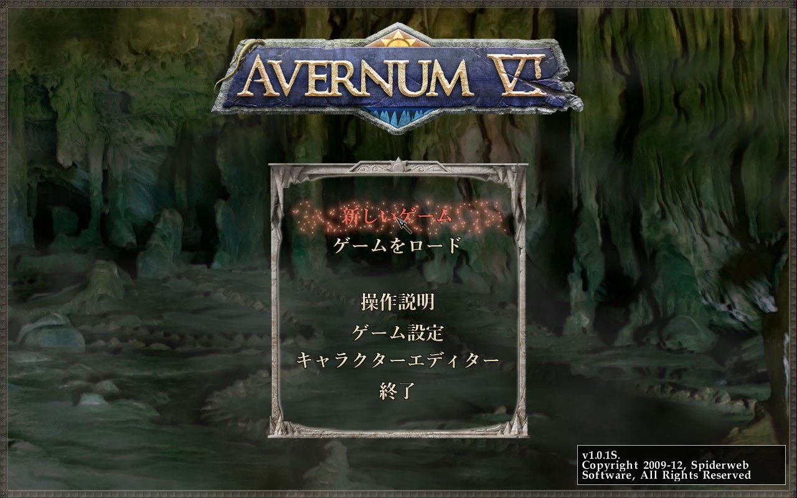

# Avernum 6 日本語化パッチ

Spiderweb Software の RPG「Avernum 6」（Steam 版）を日本語で遊べるようにする非公式パッチです。会話・本・クエスト・アイテム・画面の文字・ヘルプ・地図まで、ゲーム内のほぼすべての文章を日本語にします。

- **紹介ページ**: https://higesho.github.io/avernum6-jp/
- **ダウンロード**: [Releases](https://github.com/higesho/avernum6-jp/releases/latest) の `Avernum6_JP_<版>.zip`
- **スパイダーウェブ作品の日本語化（作品一覧）**: https://higesho.github.io/spiderweb-ja/

## 使い方
1. ZIP の中身（`dsound.dll`、`avernum_jp.ini`、`avernum_jp` フォルダ）をゲームのフォルダ（`Avernum 6.exe` のある場所）にコピーする
2. Steam からゲームを起動する

ゲームの元のファイルは書き換えません。元に戻すときは、コピーしたファイルとフォルダを削除します。詳しくは ZIP 内の `avernum_jp/README.txt` か紹介ページを見てください。

Steam 版（Windows）に対応しています。GOG 版など他のストアの版は未確認です（Steam 版と同じ exe なら動きます。対応できない版では英語のまま起動します）。

## 翻訳の規模
| 対象 | 件数 |
|---|---|
| 会話・本・イベントの文 | 18,673 |
| 人物・アイテム・呪文などの名前 | 2,810 |
| 地名・場所の名前 | 352 |
| 画面・ヘルプ・クエスト・物語 | 2,392 |
| 文字入りの画像・地図 | 25 枚 |

## 不具合・誤訳の報告
表示の崩れ、誤訳、不自然な言い回しなどは [Issues](https://github.com/higesho/avernum6-jp/issues) にお寄せください。

## 免責
本パッチは非公式のファン翻訳であり、Spiderweb Software とは関係ありません。使用は自己責任でお願いします。Avernum は Spiderweb Software の商標です。
